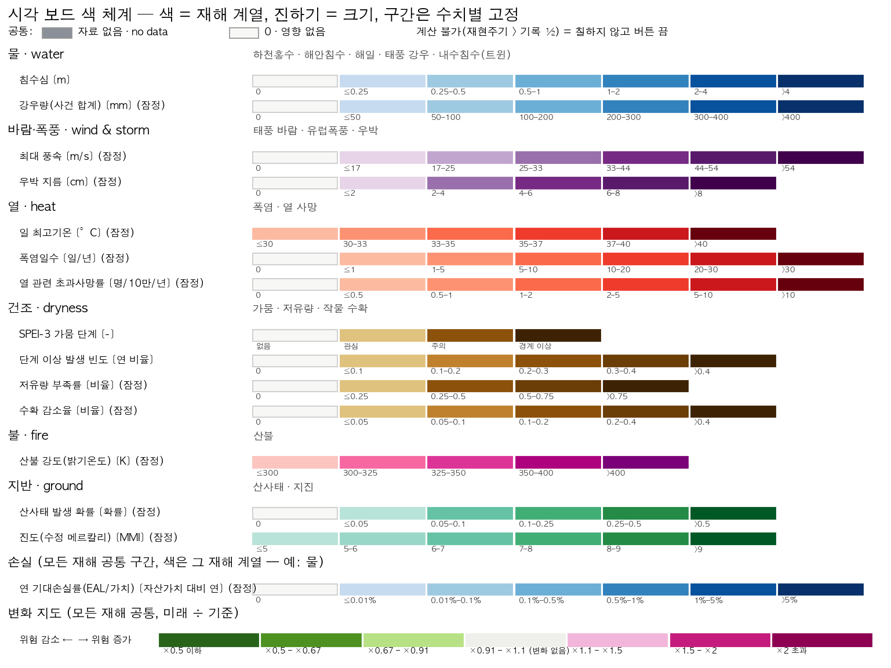

# 시각 보드 색 체계 (v1.0, 2026-11-11)

모든 지도와 범례의 색은 `assets/libraries/board_palettes.json` **한 곳**에서만 정한다.
프런트엔드(`frontend/climaterisk/src/lib/board.ts`)는 `/api/board/palettes`로 이 파일을 받아 칠하고,
보고서 그림은 `climaterisk.board.palette`를 쓴다. 코드 안에 색 값을 직접 적지 않는다.
검사는 `tests/test_board_palettes.py`가 하고, 아래 그림은 `scripts/board_color_chart.py`가 같은 파일에서 그린다.

## 1. 원칙

1. **색 = 재해 계열, 진하기 = 크기.** 한 계열은 한 가지 색상의 밝음→어두움 단계(순차 팔레트) 하나만 쓴다.
   무지개색이나 여러 색이 섞인 팔레트는 쓰지 않는다.
2. **구간은 수치(quantity)마다 고정한다.** 화면에 보이는 자료의 최솟값·최댓값으로 구간을 다시 잡지 않는다.
   그래서 재현주기·연도·시나리오·지역을 바꿔도 같은 색은 같은 값이다. 구간을 바꾸려면 이 파일의 버전을 올리고 기록한다.
3. **같은 물리량에는 같은 구간을 쓴다.** 하천·해안·해일·내수(트윈) 침수심은 모두 `water_depth_m` 하나를 쓴다.
4. **손실도 그 재해의 색으로 칠한다.** 손실률(`loss_ratio`) 구간은 모든 재해에 공통이다. 재해끼리 비교할 때 구간이 같아야 하기 때문이다.
5. **변화 지도는 모든 재해가 하나의 발산 팔레트를 쓴다.** 위험 증가는 자홍, 감소는 초록, 가운데는 무채색이다.
   값은 배율(미래 ÷ 기준)이고, 구간은 로그 대칭(½↔2, 1/1.5↔1.5, 1/1.1↔1.1)이다.
   SPEI처럼 작을수록 나쁜 지수는 지수를 그대로 쓰지 않고 "단계 이상 빈도"의 변화로 보여 준다.
6. **공통 상태색은 모든 재해에 같다.**
   - **자료 없음(null)**: 회색 `#8a8f98`. 자료 범위 밖이라 계산하지 않은 곳이다. **0과 구분한다.**
   - **0 · 영향 없음**: 거의 흰색 `#f7f7f5`. 계산했고 값이 0이거나 첫 단계 미만인 곳이다.
     기온·진도·산불 밝기온도는 0에 특별한 뜻이 없으므로 0도 가장 낮은 구간으로 칠한다(`zero_means_none: false`).
   - **계산 불가**: 재현주기가 사건 기록 길이의 ½을 넘는 경우다. 색을 칠하지 않고 버튼을 끈다. 대체값을 넣지 않는다.
   - **기준 0**(변화 지도 전용): 기준값이 0이라 배율을 낼 수 없는 곳. 흰 바탕에 회색 테두리로 표시한다.
7. **노출은 색으로 표시하지 않는다.** 속이 빈 점의 크기로만 보여 주고, 재해 색과 섞지 않는다.
8. 한 번에 재해 하나만 칠한다. 재해를 합산해서 칠하지 않는다(VISUAL_BOARD_KO §4).

## 2. 계열 (6개)

| 계열 | 색 | 재해 |
|---|---|---|
| 물 water | 파랑 (ColorBrewer Blues) | 하천홍수, 해안침수, 해일, 태풍 강우, 내수침수(트윈) |
| 바람·폭풍 wind | 보라 (PRGn 보라 팔) | 태풍 바람, 유럽폭풍, 우박 |
| 열 heat | 빨강 (Reds) | 폭염, 열 사망 |
| 건조 dryness | 갈색 (BrBG 갈색 팔) | 가뭄, 저유량, 작물 수확 |
| 불 fire | 자홍 (RdPu) | 산불 |
| 지반 ground | 청록 (BuGn) | 산사태, 지진 |

**산불이 주황이 아닌 이유.** 주황은 빨강(열)과도, 갈색(건조)과도 중간 단계에서 구분되지 않았다(OKLab ΔE 6~8).
자홍으로 바꾸니 모든 계열 쌍이 중간~진한 단계(2–4)에서 ΔE ≥ 10으로 떨어졌다.
가장 가까운 쌍은 열–불(11.4)과 물–지반(10.7)이다.

**밝은 단계는 서로 비슷하다.** 어느 색이든 아주 옅어지면 흰색에 가까워지므로 피할 수 없다.
그래서 재해는 색만으로 구분하지 않는다. 지도 제목과 범례에 재해 이름과 단위를 항상 표시한다.

## 3. 수치별 구간

| 수치 | 단위 | 구간 경계 | 근거 | 상태 |
|---|---|---|---|---|
| 침수심 `water_depth_m` | m | 0.25, 0.5, 1, 2, 4 | JRC 침수심-피해 곡선 절점(Huizinga et al. 2017) | 사용 중 |
| 강우량 `rain_mm` | mm | 50, 100, 200, 300, 400 | 카탈로그 tc_rain 절점 | 잠정 |
| 풍속 `wind_ms` | m/s | 17, 25, 33, 44, 54 | 기상청 태풍 강도: 열대폭풍·중·강·매우 강·초강력 | 잠정 |
| 우박 `hail_cm` | cm | 2, 4, 6, 8 | 카탈로그 hail 절점 | 잠정 |
| 일 최고기온 `tmax_degC` | °C | 30, 33, 35, 37, 40 | 기상청 폭염 주의보 33 °C, 경보 35 °C | 잠정 |
| 폭염일수 `heat_days_per_year` | 일/년 | 1, 5, 10, 20, 30 | 일 최고 33 °C 이상 일수 | 잠정 |
| 열 초과사망률 `heat_deaths_per_100k` | 명/10만/년 | 0.5, 1, 2, 5, 10 | 1-2-5 수열. 전국 층을 처음 만들 때 한 번 확정 | 잠정 |
| SPEI-3 단계 `spei_stage` | – | −1, −1.5, −2 | DROUGHT_AGRI_KO (McKee 1993 구분과 같음) | 사용 중 |
| 단계 이상 빈도 `share_of_years` | 연 비율 | 0.1, 0.2, 0.3, 0.4 | 10 %p 간격. **지역 비교용 아님**(§4) | 사용 중 |
| 저유량 부족률 `low_flow_deficit` | 비율 | 0.25, 0.5, 0.75 | 카탈로그 low_flow 절점 | 잠정 |
| 수확 감소율 `yield_loss_frac` | 비율 | 0.05, 0.1, 0.2, 0.4 | 카탈로그 crop_yield 절점 + 5 % 감지 하한 | 잠정 |
| 산불 강도 `fire_intensity_K` | K | 300, 325, 350, 400 | 325 K = 현재 피해함수 중간점 | 잠정 |
| 산사태 확률 `landslide_probability` | 확률 | 0.05, 0.1, 0.25, 0.5 | 카탈로그 절점 + 낮은 확률 구분 | 잠정 |
| 진도 `mmi` | MMI | 5, 6, 7, 8, 9 | 진도 VI부터 경미한 피해(EMS-98) | 잠정 |
| 연 기대손실률 `loss_ratio` | 가치 대비/년 | 0.01 %, 0.1 %, 0.5 %, 1 %, 5 % | 모든 재해 공통 | 잠정 |

**분류 규칙**: 경계값은 아래 구간에 넣는다. 예를 들어 0.25 m는 "≤ 0.25" 구간이다.
마지막 경계를 넘는 값은 모두 마지막 구간이다.
"잠정"인 수치는 그 재해를 보드에 처음 올릴 때 한 번 검토해 "사용 중"으로 바꾸고, 그 뒤로는 고정한다.

**풍속 주의.** 기상청 태풍 강도는 10분 평균 풍속이고, CLIMADA TropCyclone은 1분 지속풍이다.
그래서 같은 숫자라도 CLIMADA 값이 기상청 기준보다 약 7–12 % 세게 읽힌다(WMO 환산계수 0.88–0.93, Harper et al. 2010). 범례에 이 점을 표시한다.

**폭염 주의.** 폭염 하자드를 무엇으로 정의할지(일평균 기온 p95, UTCI, 일 최고기온 TAMAX)가 아직 정해지지 않았다(SCOPE heatwave).
또 2020년부터 기상청 특보는 체감온도를 기준으로 한다.

## 4. 가뭄 "장기 빈도" 지도의 한계

SPEI는 격자마다 그 격자의 1991–2020 기간으로 표준화한 지수다. 같은 기간 안에서 단계 이상 빈도를 세면 정의상 어디서나 비슷한 값이 나온다(전국 7~30 %).
따라서 이 지도로 "어느 지역이 가뭄이 더 잦다"고 말할 수 없다.

보드에서는 이렇게 처리한다.
- 장기 빈도 버튼마다 "지역 비교용 아님" 표시를 붙인다.
- 처음 여는 화면은 최근 큰 가뭄 해인 2022년 지도다(`drought_agri.json` `board.default_key`).

지역끼리 가뭄 정도를 비교하려면 표준화하지 않은 지표가 필요하다. 예를 들면 물 부족량(mm)이나 논의 경우 저수율이다.

## 5. 새 재해를 보드에 올릴 때

1. `perils` 표에서 그 재해의 계열을 확인한다. 새 계열은 만들지 않는 것이 원칙이다.
   꼭 필요하면 테스트의 ΔE ≥ 10 조건을 통과해야 한다.
2. 그 재해의 수치가 `quantities`에 있으면 그것을 쓴다. 없으면 새로 추가한다. 경계값마다 근거(`basis`)를 적는다.
3. 내보내는 스크립트는 레이어 메타에 `quantity`를 반드시 적는다. 적지 않으면 store가 오류를 낸다. 단위를 보고 수치를 추측하는 대체 경로는 없다.
4. 그림을 다시 그린다: `python scripts/board_color_chart.py assets/libraries/board_palettes.json docs/img/board_colors.png`

## 6. 변경 기록

| 날짜 | 버전 | 내용 |
|---|---|---|
| 2026-11-11 | 1.0.0 | 최초 정의. 6개 계열, 15개 수치, 공통 null/0/계산 불가, 변화 팔레트. 가뭄은 갈색 계열로 옮김(이전: 주황 OrRd/Oranges 혼용). |
